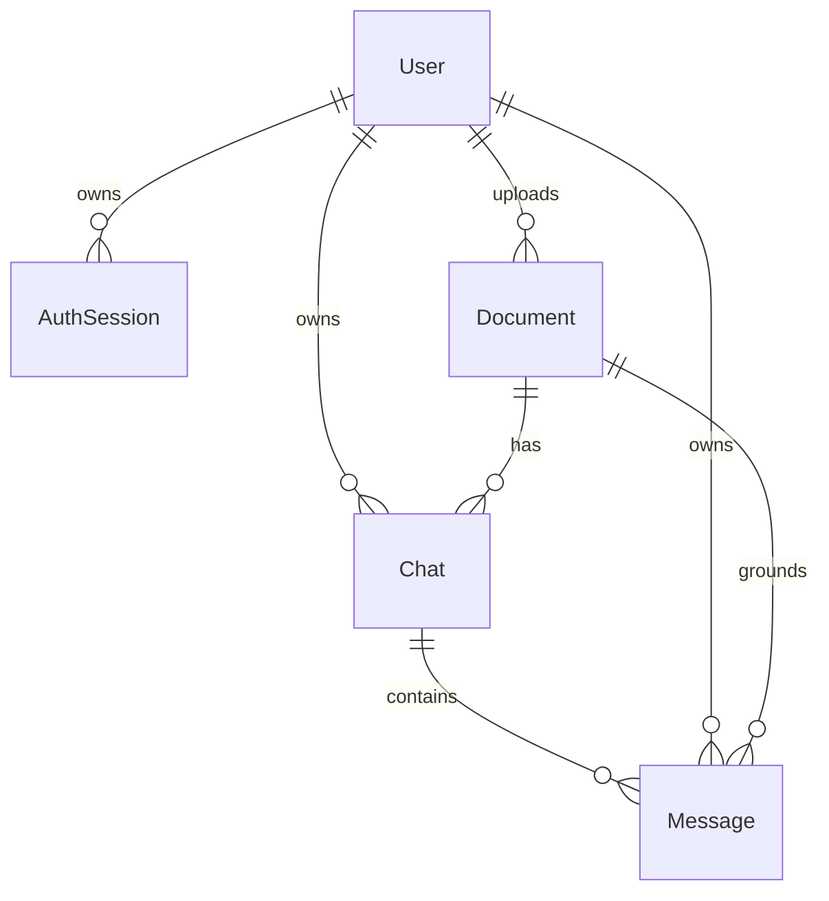

# Database module

This module defines MongoDB document shapes through Mongoose. It stores application records, not PDF bytes or Chroma vectors.

## Files and library

[index.js](index.js) exports `User`, `AuthSession`, `Document`, `Chat` and `Message`. Each exported value is a Mongoose model with query/write methods such as `findOne`, `create`, `updateOne` and `bulkWrite`. The library is `mongoose`; MongoDB is the external database server.

| Model | Collection | Purpose | Guide |
| --- | --- | --- | --- |
| User | `users` | Account identity | [User](models/User.README.md) |
| AuthSession | `auth_sessions` | Revocable refresh session | [AuthSession](models/AuthSession.README.md) |
| Document | `documents` | PDF metadata, owner and processing state | [Document](models/Document.README.md) |
| Chat | `chats` | A conversation for one user's PDF | [Chat](models/Chat.README.md) |
| Message | `messages` | User/assistant message with sources | [Message](models/Message.README.md) |

## Connection functions

The application startup imports [config/db.js](../../config/db.js), whose `connectDB()` calls `mongoose.connect(process.env.MONGO_URI)`, logs connection state and rethrows failures. [server.js](../../server.js) then waits for every model's `init()` before listening, so indexes are initialized first.

There is also a separate [config.js](config.js) in this module. Its `connectDB()` connects with the same environment variable and returns the Mongoose connection result. The active startup file does not import this duplicate helper. It is documented here as existing code, not an additional connection step you should run.

## Relationships and ownership



Each schema adds `_id`, `createdAt`, `updatedAt` and Mongoose's normal version field. References are ObjectIds with `ref` metadata; they are not database-enforced foreign keys and do not automatically cascade deletes. Controllers/repositories must verify related records and remove dependent data.

`userId` is deliberately repeated on documents/chats/messages so queries can scope access. A valid ObjectId alone is not permission to read a record. Ownership must be part of the query; schema `required` validation does not prove the relationship points to the correct user's data.

## Internal usage example

```javascript
const { Document } = require('./modules/database');
// userId must come from verified authentication, not req.body.
const documents = await Document.find({ userId }).sort({ createdAt: -1 }).lean();
```

For complete field/index descriptions and examples, start with the [model index](models/README.md). The chat repository's journal implements recoverable turn persistence; the schemas do not make multi-document writes transactional by themselves.
